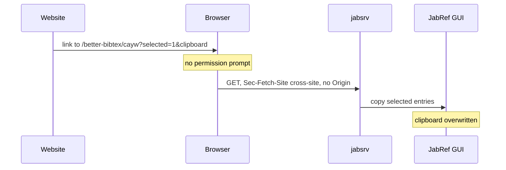
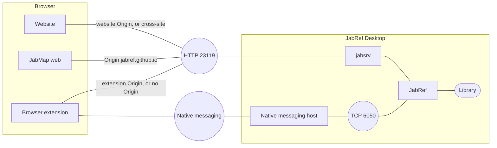
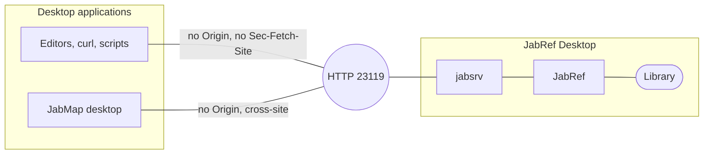
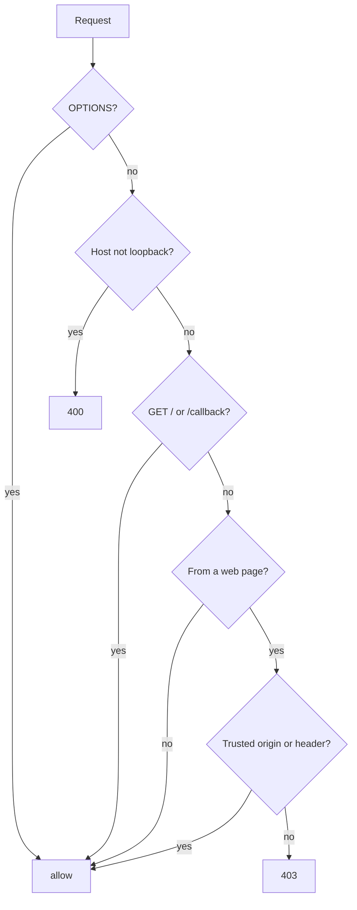

# Accept jabsrv requests from browsers only from trusted callers

`adr~jabsrv.trusted-callers~1`

## Context and Problem Statement

The HTTP server (`jabsrv`, port 23119, off by default) has no request filter and answers every request with `Access-Control-Allow-Origin: *` ([`CORSFilter`](https://github.com/JabRef/jabref/blob/9b8a93e48a5a410ea6c3a0726663293ee241fd0f/jabsrv/src/main/java/org/jabref/http/server/CORSFilter.java)).
While it runs, a website can call it.

Firefox and Chrome ask the user before a website fetches from localhost.
They do not ask for a link or a form.
A link to `/better-bibtex/cayw?selected=1&clipboard` overwrites the clipboard.
A `text/plain` form sent to `/libraries/current/entries` opens the import dialog ([`EntriesResource`](https://github.com/JabRef/jabref/blob/9b8a93e48a5a410ea6c3a0726663293ee241fd0f/jabsrv/src/main/java/org/jabref/http/server/resources/EntriesResource.java#L129-L155)).
With DNS rebinding, a website can also call jabsrv like a local page, because `Host` is not checked.

The two block diagrams (FMC notation) show who talks to jabsrv.
Each line is labelled with the headers jabsrv receives.
The measurements are in [Request headers of clients](../code-howtos/http-server.md).

Browser to JabRef:

Desktop application to JabRef:

Which requests should jabsrv accept?

## Decision Drivers

* A website must not read or change a library or trigger an action in JabRef.
* The published browser extension, JabMap, CAYW clients, and the CiteDrive login must keep working.
* No new preference and no pairing step.

## Considered Options

* Keep jabsrv as it is
* Origin allowlist, `X-JabRef-Connector` header, and PIN pairing
* Require `X-JabRef-Connector` on requests with an `Origin` header
* Check `Host`, `Sec-Fetch-Site`, and `Origin`

## Decision Outcome

Chosen option: "Check `Host`, `Sec-Fetch-Site`, and `Origin`", because the browser sets these headers and a website cannot change them, and the existing clients already send what is needed.

A `ContainerRequestFilter` handles each request. The first matching row applies.

| # | Request | Result |
| --- | --- | --- |
| 1 | `OPTIONS` (CORS preflight) | allow |
| 2 | Server listens on loopback, and `Host` is not `localhost`, `127.0.0.1`, or `[::1]` | 400 |
| 3 | `GET /` (static page) or `GET /callback` (OAuth redirect, protected by `state`) | allow |
| 4 | No `Origin`, and `Sec-Fetch-Site` is absent, `none`, or `same-origin` (editors, curl, typed URLs) | allow |
| 5 | `Origin` is a browser extension (`chrome-extension://`, `moz-extension://`, `safari-web-extension://`) | allow |
| 6 | `Origin` is `https://jabref.github.io` or a localhost origin (JabMap web, local development) | allow |
| 7 | `X-JabRef-Connector` is present (desktop applications with a browser engine, e.g., JabMap desktop) | allow |
| 8 | Everything else | 403 |

"From a web page" means row 4 does not match. "Trusted origin or header" means rows 5 to 7.

`CORSFilter` must not allow `X-JabRef-Connector`.
A website could send the header otherwise.

Other users on the same computer are not covered.
See [ADR-0085](0085-protect-jabsrv-against-other-local-users-with-an-opt-in-token.md).

### Consequences

* Good, because links, forms, and fetches from websites are rejected, even after the user allowed local network access for the site.
* Good, because the published extension, JabMap web, CAYW clients, and the CiteDrive login work unchanged.
* Good, because there is no preference and no stored secret.
* Bad, because JabMap desktop sends no `Origin` and has to add `X-JabRef-Connector`.
* Bad, because `https://jabref.github.io` is hard-coded. A new web client needs a code change.
* Bad, because a link to jabsrv on a web page (e.g., in the documentation) returns 403. Typing the URL works.
* Bad, because `Sec-Fetch-Site` is missing in Safari before 16.4 and for plain HTTP to a non-loopback address (`--host`, Docker). Only the `Origin` check protects there.

### Confirmation

The filter carries the tag `[impl->adr~jabsrv.trusted-callers~1]`.
Unit tests cover each row of the table.
One more test checks that `CORSFilter` does not allow `X-JabRef-Connector`.

## Pros and Cons of the Options

### Keep jabsrv as it is

* Good, because nothing changes.
* Bad, because any website can call jabsrv.

### Origin allowlist, `X-JabRef-Connector` header, and PIN pairing

Implemented in [#15295](https://github.com/JabRef/jabref/pull/15295).

* Good, because fetches from websites are rejected.
* Bad, because the published extension stops working until it sends the header and a token.
* Bad, because requests without `Origin` need a token, too. This breaks CAYW clients, curl, and the CiteDrive login. A preference turns the token off, but then links from websites pass again.
* Bad, because the PIN needs UI and token storage, and it only protects against programs that can read the library files anyway.

### Require `X-JabRef-Connector` on requests with an `Origin` header

* Good, because it is a small check.
* Bad, because JabMap web and the published extension do not send the header.
* Bad, because links and images carry no `Origin`, so they are not checked.
* Bad, because DNS rebinding still works.

### Check `Host`, `Sec-Fetch-Site`, and `Origin`

OWASP describes this check in its [CSRF cheat sheet](https://cheatsheetseries.owasp.org/cheatsheets/Cross-Site_Request_Forgery_Prevention_Cheat_Sheet.html), and Go 1.25 ships it as [`http.CrossOriginProtection`](https://alexedwards.net/blog/preventing-csrf-in-go).
Zotero protects its local server with a custom header and a `Host` check ([zotero/zotero@2603373](https://github.com/zotero/zotero/commit/2603373b860acb555062c01a5bb434d6c712aa3e)).

* Good, because it covers links and forms, which the other options miss.
* Good, because no client release is needed.
* Bad, because the trusted origins are hard-coded.
* Bad, because it depends on `Sec-Fetch-Site`.

## More Information

* [#15295](https://github.com/JabRef/jabref/pull/15295): Add security hardening to HTTP server for browser extension communication
* [#15378](https://github.com/JabRef/jabref/pull/15378): Implement Custom URL Protocol Handling
* [JabRef-Browser-Extension-experimental#50](https://github.com/JabRef/JabRef-Browser-Extension-experimental/pull/50)
* [Chrome: Local Network Access](https://developer.chrome.com/blog/local-network-access)
* [Firefox 153 release notes](https://www.firefox.com/firefox/153.0/releasenotes/)
