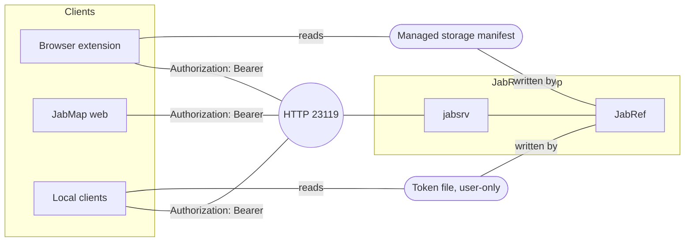

# Protect jabsrv against other local users with an opt-in token

`adr~jabsrv.local-user-token~1`

## Context and Problem Statement

On a computer, several users can be logged in at the same time (e.g., on a terminal server).
Their files are protected by file access rights.
A port opened on `localhost` is not protected that way: every local user can connect to it.

jabsrv listens on such a port.
The request filter of [ADR-0084](0084-accept-jabsrv-requests-from-browsers-only-from-trusted-callers.md) rejects websites.
It accepts every request without `Origin` and `Sec-Fetch-Site`, because local clients, such as CAYW clients and scripts, send such requests.
A program of another user sends the same kind of request and is accepted.
This lets another user read and change a library through jabsrv, even without access to the library file.

The single-instance listener on port 6050 is open to other local users as well.
It is on by default and reads serialized Java objects from every local connection ([`Protocol`](https://github.com/JabRef/jabref/blob/9b8a93e48a5a410ea6c3a0726663293ee241fd0f/jablib/src/main/java/org/jabref/logic/remote/Protocol.java#L73-L74)).
It is not part of this decision.

How can jabsrv reject other local users without breaking single-user setups?

## Considered Options

* Do not protect against other local users
* Opt-in token; the Firefox extension reads it from managed storage
* Opt-in token; the extension gets it from the native messaging host
* Check which user owns the TCP connection

## Decision Outcome

Chosen option: "Opt-in token; the Firefox extension reads it from managed storage", because JabRef can set it up alone: no installer, no extra process, no administrator rights.

A preference turns the token on.
JabRef then writes a token to a file that only the user can read, like the `tokenFile` of the fulltext provider ([#16124](https://github.com/JabRef/jabref/pull/16124)), and jabsrv requires `Authorization: Bearer <token>`.
CORS preflights, `GET /`, and `GET /callback` stay open, as in rows 1 and 3 of ADR-0084: browsers send no `Authorization` header with a preflight or a redirect.
Local clients, such as CAYW clients and scripts, read the token from the file.
For the Firefox extension, JabRef also writes the token to the extension's managed storage manifest (`~/.mozilla/managed-storage/@jabfox.json` on Linux), and the extension reads it with `browser.storage.managed`.
JabMap web cannot read either file, so it asks the user for the token once.
For that, `CORSFilter` has to allow the `Authorization` header.

### Consequences

* Good, because a request from another user has no token and is rejected.
* Good, because nothing changes for users who leave the preference off.
* Bad, because with the preference on, every local client, such as CAYW clients, has to send the token.
* Bad, because JabMap web needs a field for the token. JabMap desktop can read the token file instead.
* Bad, because the CiteDrive export page cannot send the token and stops working with the preference on.
* Bad, because it covers only Firefox. Chrome has managed storage only through an enterprise policy.
* Bad, because two users still cannot both use port 23119.

### Confirmation

Unit tests check that a request without the token gets 401, and that preflights and `GET /callback` pass without it.

Managed storage is not tested yet.
It has to be tried on Linux, Windows, and macOS, and with the snap and Flatpak packages of Firefox, which may not see `~/.mozilla`.

## Pros and Cons of the Options

### Do not protect against other local users

* Good, because nothing changes.
* Bad, because another user can read and change the library through jabsrv.

### Opt-in token; the Firefox extension reads it from managed storage

See [Native manifests](https://developer.mozilla.org/en-US/docs/Mozilla/Add-ons/WebExtensions/Native_manifests) for the manifest locations.

* Good, because JabRef writes the manifest itself.
* Good, because the extension already has the `storage` permission.
* Bad, because it is Firefox only.

### Opt-in token; the extension gets it from the native messaging host

Proposed in the review of [#15295](https://github.com/JabRef/jabref/pull/15295).

* Good, because it works in Firefox and Chrome.
* Bad, because the native messaging host has to be installed. It is missing for a portable build and when JabRef runs from source.

### Check which user owns the TCP connection

* Good, because no client changes.
* Bad, because each operating system needs its own code.
