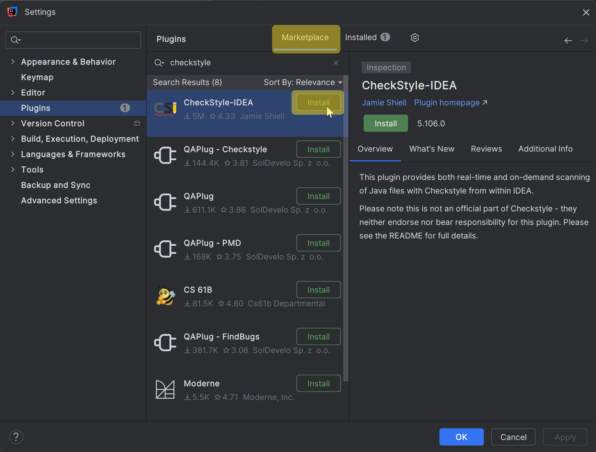
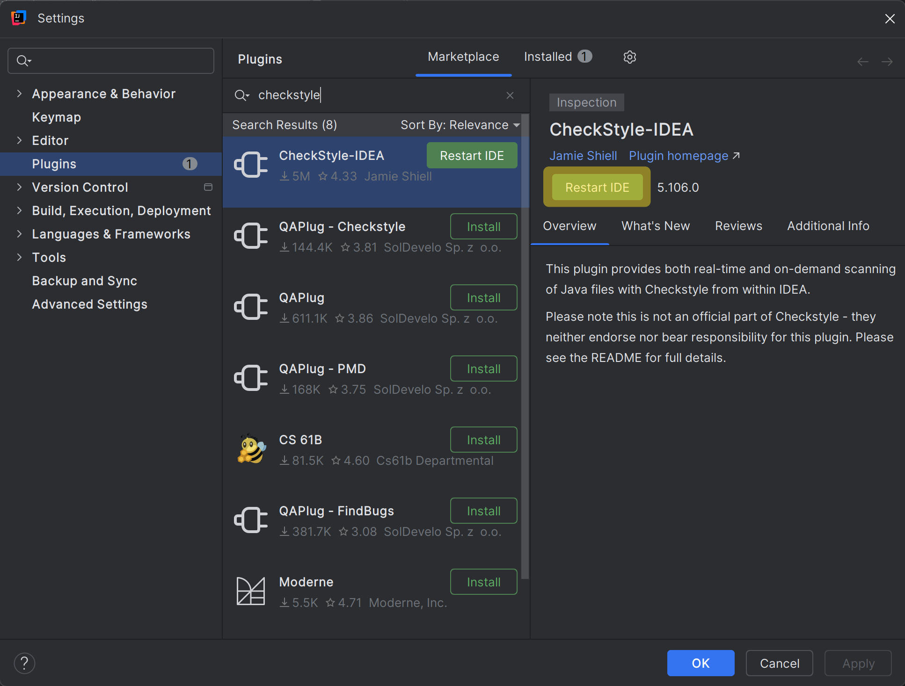
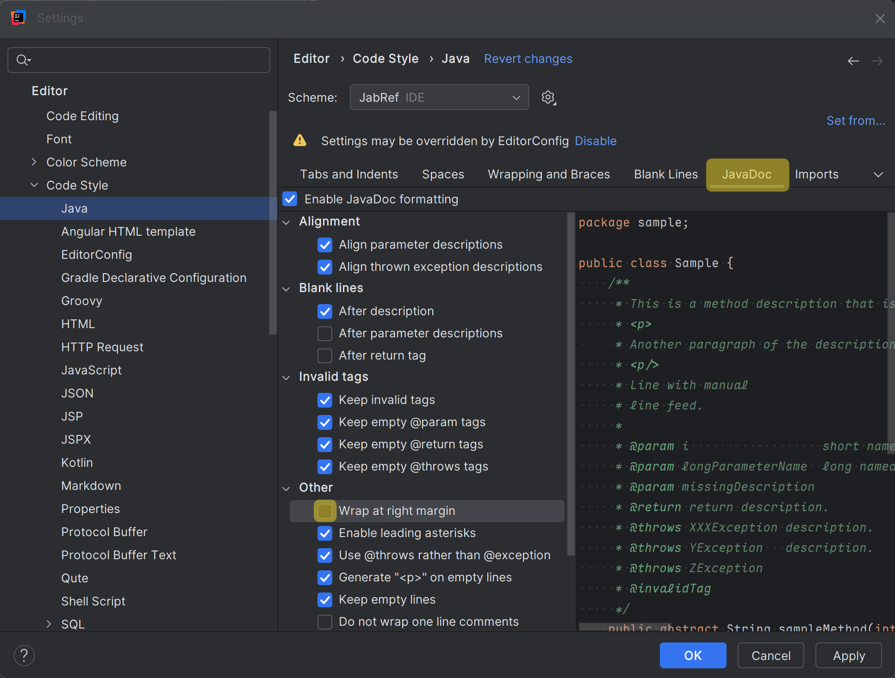
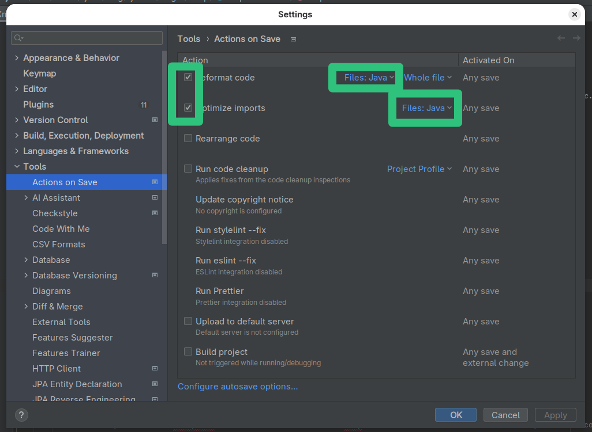
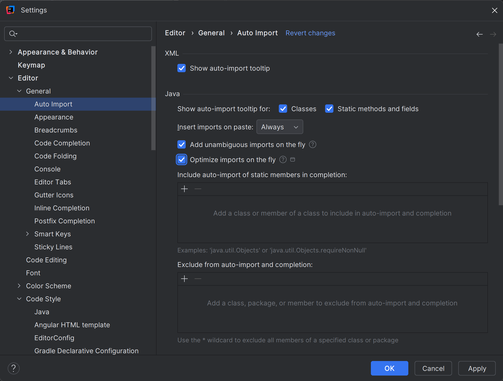
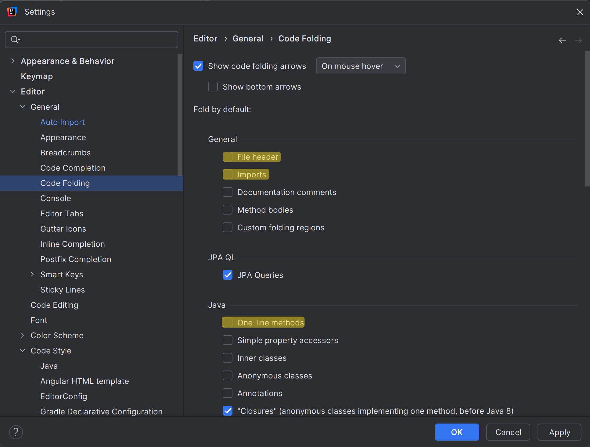
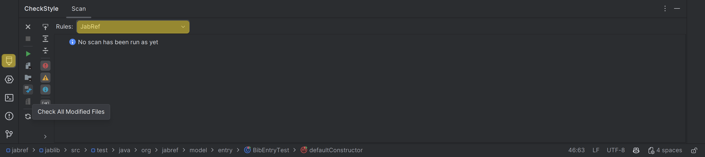

# Step 3: Set up JabRef's code style

Contributions to JabRef's source code need to have a code formatting that is consistent with existing source code.
JabRef's Java sources are formatted with [jfmt](https://github.com/Netflix/jfmt), which has exactly one style and is run through Gradle.
Additionally, JabRef provides check-style definitions and an IntelliJ code style that approximates jfmt's output.

Install the [CheckStyle-IDEA plugin](http://plugins.jetbrains.com/plugin/1065?pr=idea), it can be found via the plug-in repository:
Navigate to **File > Settings... > Plugins"**.
On the top, click on "Marketplace".
Then, search for "Checkstyle".
Click on "Install" choose "CheckStyle-IDEA". 
**Note:** In some MacBooks, `Settings` can be found at the "IntelliJ" button of the app menu instead of at "File".





After clicking, IntelliJ asks for confirmation:





If you agree, click on "Agree" and you can continue.

Afterward, use the "Restart IDE" button to restart IntelliJ.





Click on "Restart" to finally restart.

Wait for IntelliJ coming up again.

## Have auto format working properly in JavaDoc

To have auto format working properly in the context of JavaDoc and line wrapping, "Wrap at right margin" has to be disabled. Details are found in [IntelliJ issue 240517](https://youtrack.jetbrains.com/issue/IDEA-240517).

Go to **File > Settings... > Editor > Code Style > Java > JavaDoc**.

At "Other", disable "Wrap at right margin"





## Format with jfmt

The source of truth for formatting is [jfmt](https://github.com/Netflix/jfmt).
The CI check runs `./gradlew jfmtCheck`; `./gradlew jfmt` rewrites all Java sources.
IntelliJ's own formatter ("Reformat code", <kbd>Ctrl</kbd> + <kbd>Alt</kbd> + <kbd>L</kbd>) is configured to come close, but it cannot replicate jfmt's structural line breaking.
Therefore, run jfmt before committing.

To run jfmt on the current file from within IntelliJ, add an external tool:

Go to **File > Settings... > Tools > External Tools** and click on "+".

1. Name: `jfmt`
2. Program: `$ProjectFileDir$/gradlew` (on Windows: `$ProjectFileDir$\gradlew.bat`)
3. Arguments: `jfmt --offline --quiet`
4. Working directory: `$ProjectFileDir$`
5. Check "Synchronize files after execution"
6. Press "OK"

The tool is then available at **Tools > External Tools > jfmt**.
Assign a keyboard shortcut to it at **File > Settings... > Keymap** (search for "jfmt") if you like.

Alternatively, run the Gradle task `jfmt` from the Gradle tool window (group "formatting").

{: .note }
> jfmt formats all modules at once, which takes a few seconds, because it resolves the referenced types to clean up imports.
> Subsequent runs on unchanged modules are up-to-date in Gradle and skipped.

## Enable optimize imports on save

IntelliJ can automatically clean up imports on save.
Please make use of this functionality.

Go to **File > Settings... > Tools > Actions on Save**.

1. Check "Optimize imports"
2. Click on "All file types" (on the right)
3. Uncheck "All file types" to disable it
4. Check "Java"

Do **not** enable "Reformat code" on save: IntelliJ's formatter and jfmt differ in line breaking, and the two would fight each other.





## Enable proper import cleanup

To enable "magic" creation and auto cleanup of imports, go to **File > Settings... > Editor > General > Auto Import**.
There, enable both "Add unambiguous imports on the fly" and "Optimize imports on the fly"
(Source: [JetBrains help](https://www.jetbrains.com/help/idea/creating-and-optimizing-imports.html#automatically-add-import-statements)).





Press "OK".

## Disable too advanced code folding

Go to **File > Settings... > Editor > General > Code Folding**.
At section "General", disable "File header" and "Imports".
At section "Java", disable "One-line methods".





Press "OK".

## Run checkstyle

In the lower part of IntelliJ's window, click on "Checkstyle".
In "Rules", change to "JabRef".
Then, you can run a check on all modified files.





## Final comments

{: .highlight }
> Now you have configured IntelliJ completely.
> You can run the main application using Gradle and the test cases using IntelliJ.
> jfmt formats the code - and the most common styling issue at imports is automatically resolved by IntelliJ.
> Finally, you have Checkstyle running locally so that you can check for styling errors before submitting the pull request.

Got it running? GREAT! You are ready to lurk the code and contribute to JabRef. Please make sure to also read our [contribution guide](https://devdocs.jabref.org/contributing#contribute-code).

<!-- markdownlint-disable-file MD033 -->
